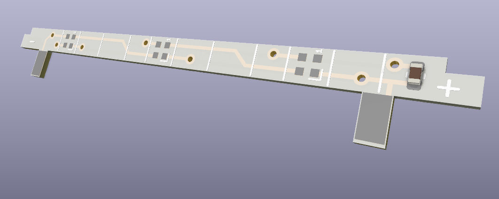

# Fliipper Zero RGB PCB
  
This it Kicad 6.0 project for Flipper Zero rgb backlight PCB  
Use the maintained [official firmware + RGB fork](https://github.com/hitriy/flipperzero-firmware-rgb), based on [Quen0n's original RGB patch](https://github.com/quen0n/flipperzero-firmware-rgb). New official stable releases are automatically patched and built.  

**[Install with the web flasher](https://hitriy.github.io/flipperzero-firmware-rgb/)** · [Download firmware releases](https://github.com/hitriy/flipperzero-firmware-rgb/releases)  
The web flasher works in desktop Chrome or Edge over USB. Close qFlipper first and insert a microSD card. Use qFlipper for DFU recovery.  

Feel free to ask any questions or provide suggerstons to [me](https://t.me/hitriy)  
Here's the [replacement guide](https://telegra.ph/Flipper-Zero-RGB-backlight-guide-12-26)  
You can thank me by byuing my a beer [here](https://www.buymeacoffee.com/hitriy)
